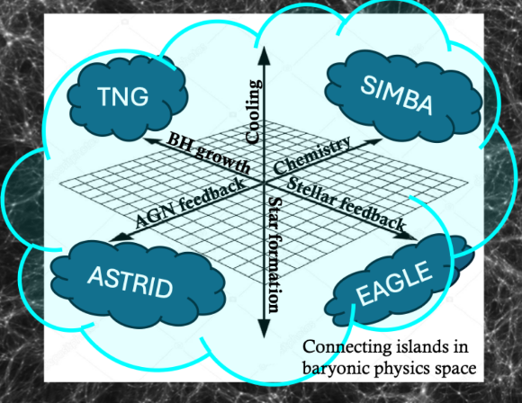

+++
title = "SWIFTcon 2026"
date = 2026-10-20
[extra]
time = 15
location = "Universiteit Leiden"
revealplugins = [
    { name = "RevealNotes", url = "@/js/reveal-notes.js"},
    { name = "RevealMath.MathJax4", url = "@/js/math.js"},
    { name = "RevealMermaid", url = "https://cdn.jsdelivr.net/npm/reveal.js-mermaid-plugin@11.12.3/plugin/mermaid/mermaid.js"},
]

[extra.revealoptions]
mermaid = {theme = "dark", themeVariables = { darkMode = true }}
+++

{% <slide time={30} width="75%" background_mov="background_movie.mp4"> %}
<div style="background-color: var(--crust);">

## SWIMBA: A reimplementation of SIMBA feedback in SWIFT
### Sagan Sutherland
with Daniel Anglés-Alcázar and the CAMELS collaboration
</div>


Say I'm a PhD student at the University of Connecticut




## SWIMBA

<div class="vcenter">


What is simba?
Say what it is before we talk about the details of it.
Make the intro as **specific** as possible with respect to simulations!
This is a simulator conference after all


- Take the AGN and stellar feedback prescriptions from SIMBA (Davé+19) and re-implement them in a new subgrid model.
- Implemented in **SWIFT** (Schaller+24) as compared to SIMBA implemented in GIZMO (Hopkins+14).
- Takes other processes like chemistry and star formation from Swift-EAGLE.

**Tuned to match SIMBA's z=0 summary statistics!**
</div>
<div class="vcenter">
{{ <video src="simba_swimba_compare.mp4" attrs=`data-autoplay loop style="max-height: 85vh"`/> }}
</div>






<div class="vcenter">
<p>
A comparison of <span style="color: #D55E00;">SWIMBA</span> and <span style="color: #2094b5;">SIMBA</span> in many key quantities, showing the range of their cosmic variance.
</p>

- 27 runs
- 27 initial conditions
- Same physics

</div>

{{ <figure src="CV.svg" height="90vh"/> }}



Each has a set of 27 separate runs, each with different initial conditions.
Colored ranges show the full extent of the 27 runs, and lines show the medians.






<div class="elementhcenter" data-id="header">
<h2 class="withbase" style="padding: 0.1em">power spectra</h2>
</div>
{{ <figure src="CV.svg" height="90vh" zoom={2.3} on={[0.53, 0.5]} style="z-index: -1;"/> }}
<div class="withbase" style="position: absolute; right: 0vw; top: 65vh;" data-id="legend_background">
{{ <figure src="CV_legend.svg" height="19vh" attrs="data-no-animate"/> }}
</div>





<div class="elementhcenter" data-id="header">
<h2 class="withbase" style="padding: 0.1em">baryon fraction</h2>
</div>
{{ <figure src="CV.svg" height="90vh" zoom={3} on={[0.35, 0.97]} style="z-index: -1;"/> }}
<div class="withbase" style="position: absolute; left: 0vw; top: 25vh;" data-id="legend_background">
{{ <figure src="CV_legend.svg" height="19vh" attrs="data-no-animate"/> }}
</div>




<div class="elementhcenter" data-id="header">
<h2 class="withbase" style="padding: 0.1em">stellar mass &mdash; black hole mass</h2>
</div>
{{ <figure src="CV.svg" height="90vh" zoom={3} on={[0.35, 1.22]} style="z-index: -1;"/> }}
<div class="withbase" style="position: absolute; left: 0vw; top: 25vh;" data-id="legend_background">
{{ <figure src="CV_legend.svg" height="19vh" attrs="data-no-animate"/> }}
</div>




## How did we make SWIMBA?
Development was spearheaded by Romeel Davé &amp; Doug Rennehan.
<br>
Tuning the model was my responsibility.

<div class="mermaid fragment" style="transform: translate(1em, -2em);">
<pre>
flowchart LR
Init --> A1{v0.1};
Init --> A2{v0.2};
Init --> A3{v0.3};
A3 --> B1{v1.1};
A3 --> B2{v1.2};
A3 --> B3{v1.3};
B2 -. "For two years..." .-> C{v100}
C --> D1{v101.1};
C --> D2{v101.2};
C --> D3{v101.3};
C --> D4{v101.4};
D1 --> E1{v102.1};
D1 --> E2{v102.2};
D1 --> E3{v102.3};
E3 --> SWIMBA!
style Init fill:darkgreen;
style A3 fill:darkgreen;
style B2 fill:darkgreen;
style C fill:darkgreen;
style D1 fill:darkgreen;
style E3 fill:darkgreen;
style SWIMBA! fill:darkgreen;
classDef bigtext font-size:17pt;
class Init,A1,A2,A3,B1,B2,B3,C,D1,D2,D3,D4,E1,E2,E3,SWIMBA! bigtext;
linkStyle 6 font-size:17pt;
</pre>
</div>

<div class="fragment r-stack">


</div>


Did I do something clever? swiftemulator? Nope! Brute force baby.

Each step has its own big multipanel plot. I manually picked the next set of parameters based on what I thought would bring the match closer together.





## Why did we make SWIMBA?



## Why did we make SWIMBA?
<div data-auto-animate-delay="1">

**We want to be able to use machine learning to infer cosmology!**
</div>


<div class="fragment">

### Robustness
- Robust ML models are able to make accurate predictions about unseen physical models
- For example, machine learning techniques tend to have poor robustness when trained on only one model.
- Poor robustness of a model decreases our trust in its results.
</div>
<div class="fragment">

### Model Similarity
- SWIMBA implements much of the same physics as SIMBA. And it produces similar results to SIMBA.
- It stands to reason that a model trained in SIMBA could make good predictions about SWIMBA.
</div>

<div class="fragment">

### Speed

<div></div>

- SWIMBA can run much faster than SIMBA.
- This allows us to make larger datasets cheaper!

| SWIMBA | 1000 CPUh |
|-------:|-----------|
| SIMBA  | 4800 CPUh |
<div></div>

</div>




<div class="vcenter">

## CAMELS


#### {{red}}C</span>osmology and {{red}}A</span>strophysics with {{red}}M</span>achin{{red}}E</span> {{red}}L</span>earning {{red}}S</span>imulations
- Large training dataset including thousands of simulations.
- Varying cosmological parameters so that we can try to predict those.
- Also vary astrophysical parameters to try and smooth over the uncertainty in baryonic physics.

We already have a SIMBA dataset, and I have recently added an analogous SWIMBA dataset!
</div>
<div class="hcenter">
{{ <figure src="camels.jpg" width="35vw" style="margin-bottom: 0;"/> }}
<p style="margin-top: 0;"><small>(Villaescusa-Navarro+21)</small></p>
</div>



{% <slide background_img="background.jpg" width="75%"> %}
<div class="withbase" style="padding-top: 0.5pt; padding-bottom: 0.5pt;">

Our new SWIMBA suite contains 2164 individual simulations, for a total simulated volume of more than $\\left(323\\,\\mathrm{Mpc/h}\\right)^3$!

We will soon be expanding SWIMBA from $\\left(25\\,\\mathrm{Mpc/h}\\right)^3$ to $\\left(50\\,\\mathrm{Mpc/h}\\right)^3$ simulations.

Over the course of this project I have developed<br>
[camels-post](https://www.github.com/smsutherland/camels-post): a post-processing pipeline combining 7 different tools to generate data products from simulation our snapshots<br>
[nbody-setup](https://www.github.com/smsutherland/nbody-setup): a tool to quickly and (relatively) easily prepare suites of N-body simulations.

{{ <note n="Come and find me if you want to use the data :)"/> }}
{{ <note n="from galaxy catalogs to cosmic web filaments to... images like this"/> }}
</div>




{{ <figure src="random_map.png" width="50vw"/> }}
<div class="vcenter">
<div>
Villaescusa-Navarro+21 showed cosmological parameters can be predicted using only the projected maps like this one:
{{ <note n="note that these are early tests"/> }}

<div class="vcenter" style="font-size: 2.5em;">
➔
</div>

|           | *Ω<sub>m</sub>* | *σ<sub>8</sub>* |
|----------:|---------------|---------------|
| Predicted | 0.1498        | 0.9594        |
|    Actual | 0.1414        | 0.9786        |


Now can we take this model, trained on images of SIMBA, and make predictions about SWIMBA?
</div>
</div>



This map is a matter projection, but there are a variety of fields we could look at.

We're looking at a projection through a 5Mpc/h wedge through the simulation volume.





<div class="vcenter">

Our preliminary results show...

When our image is of the total matter density,<br>**we can!**

</div>
{{ <figure src="SwimbaSIMBA_Mtot_0.svg" height="80vh"/> }}





<div class="vcenter">

Unfortunately, quantities more dependent on the baryonic physics (such as temperature)<br>**can't achieve the same robustness**.
</div>
{{ <figure src="SwimbaSIMBA_T_0.svg" height="80vh"/> }}




## Now for the more technical side of things!
{{ <note n="Can you tell where the swiftcon part of the talk began?"/> }}



## FoF Galaxies
<br>

<div class="fragment" data-fragment-index="1">

### SIMBA black holes
- seeded in galaxies rather than halos
- seeded based on galaxy stellar mass
- require knowledge of their whole host galaxy
  - *not* just particles within their kernel
</div>

<div class="fragment" data-fragment-index="2">

To that end, the FoF algorithm in SWIFT has been adapted to
- Identify individual galaxies
- store galaxy information within the constituent particles

{#This has lead to work trying to model galaxies fully empirically based solely on halo properties.#}
</div>

<p class="fragment" data-fragment-index="2">This is less accurate than bringing in VELOCIraptor for proper sub-structure finding,<br>but but runs with the speed of the FoF.</p>
{{ <note n="I'm probably missing some detail about the FoF galaxies because, again, development on this was led by Romeel and Doug. I had no part in it until it was mostly a finished product."/> }}
{{ <note n="This leads into some other interesting work I'm doing"/> }}



## Interesting Aside: [ECHOES](https://www.github.com/smsutherland/ECHOES) ⚠️Work in progress⚠️
Fully empirical galaxy modeling! Based solely on halo properties.

Custom FoF modifications to store halo quantities in black holes!

Identify the central black hole with very little extra computation!
{{ <video src="BH_9853_tri-axis.mp4" attrs=`data-autoplay loop style="width: 75%;"`/> }}



## Interesting Aside: [ECHOES](https://www.github.com/smsutherland/ECHOES) ⚠️Work in progress⚠️
Custom FoF modifications to store halo quantities in black holes!



<div>
This is currently how I'm handling it, but there's no reason this functionality has to be ECHOES-specific.

Is this functionality something other people would be able to make use of?
I'm not opposed to upstreaming if there's demand.
Alternately, am I just re-inventing the wheel here?

Pretty pretty please come talk to me if you have thoughts/opinions!
Currently I only pass in the 3 properties ($r^2$, M<sub>halo</sub>, and is_central) I need, but if there's a more general way of passing more fof properties, I'd love to hear it!

</div>
<div>

In `black_holes.h`
```c
__attribute__((always_inline)) INLINE static float
black_holes_central_priority(
    const struct black_holes_props *const props,
    const struct bpart *const bp
);

__attribute__((always_inline)) INLINE static void
black_holes_update_fof_properties(
    const struct black_holes_props *const props,
    float r2,
    float group_mass,
    int is_central,
    struct bpart *const bp
);
```
</div>




## Interesting Aside 2: Mix-n-Match Simulations


- Utilize the modular nature of SWIFT to create hybrid models.
  - For example, combining EAGLE's stellar feedback with SWIMBA's AGN feedback and vice versa.
- SWIMBA is already a sort of hybrid simulation between SIMBA and EAGLE.
- This is not something we've explored with much depth yet, but achieving this would be very relevant for CAMELS purposes.
- ⚠️Work in not even in progress yet⚠️

<div class="hcenter">


<p style="margin-top: 0;"><small>(Anglés-Alcázar)</small></p>
</div>



{% <slide width="75%" background_mov="background_movie.mp4"> %}



<div style="background-color: var(--crust);">

## Conclusion!

- SWIMBA and SIMBA produce similar summary statistics!
- Even so, based on our initial robustness tests, the maps are distinct enough that we lose machine learning robustness.
- SWIMBA data is available to be used! Please reach out if you could make use of such a dataset.
  - [sagan.sutherland@uconn.edu](mailto:sagan.sutherland@uconn.edu)
- We provide open-source tools for generating our data products [here](https://www.github.com/smsutherland/camels-post) and [here](https://www.github.com/smsutherland/nbody-setup).
- Slides available at [{{ get_url(path=page.path) }}]({{ get_url(path=page.path) }}) 
<br><br>
### SWIMBA Paper coming soon to an arxiv near you!
</div>




<div class="elementhcenter" data-id="header">
<h2 class="withbase" style="padding: 0.1em">max circular velocity</h2>
</div>
{{ <figure src="CV.svg" height="90vh" zoom={3} on={[0.65, 1.22]} style="z-index: -1;"/> }}
<div class="withbase" style="position: absolute; left: 10vw; top: 25vh;" data-id="legend_background">
{{ <figure src="CV_legend.svg" height="20vh" attrs="data-no-animate"/> }}
</div>



## max circular velocity
Adaptive softenings in gizmo change the density profile of galaxies.
{{ <figure src="adaptive_fixed.svg" width="100vw"/> }}



{{ <figure src="SwimbaSIMBA_Mtot_1.svg" height="80vh"/> }}
{{ <figure src="SwimbaSIMBA_T_1.svg" height="80vh"/> }}



{{ <figure src="SwimbaSIMBA_Mtot_2345.svg" height="90vh"/> }}
{{ <figure src="SwimbaSIMBA_T_2345.svg" height="90vh"/> }}



## Differences in star formation results...
{{ <figure src="SFR_compare.svg" height="90vh"/> }}

